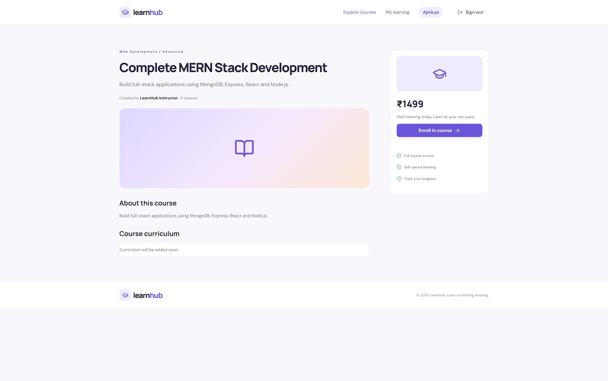
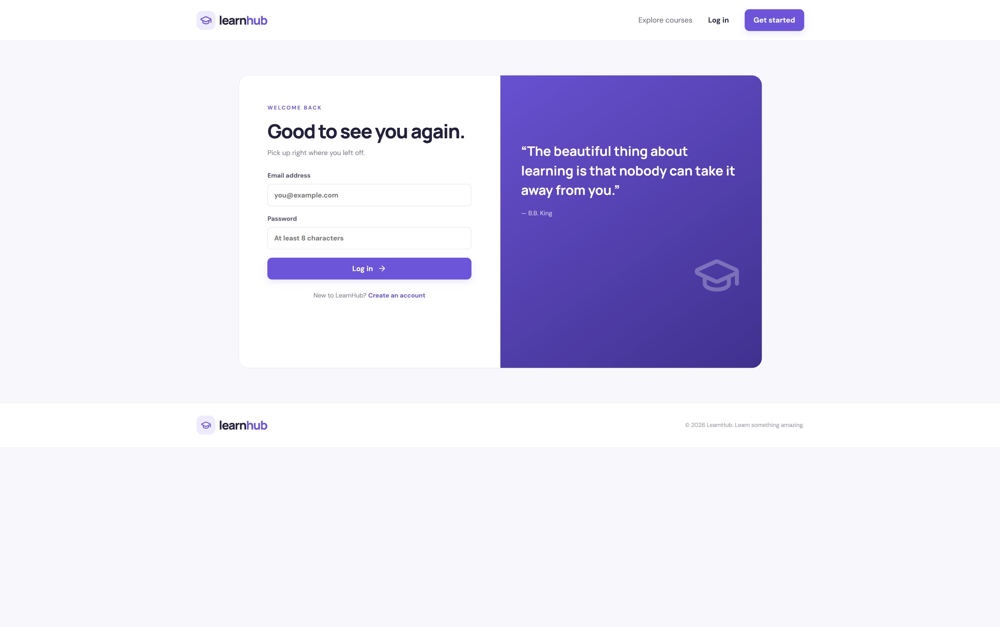
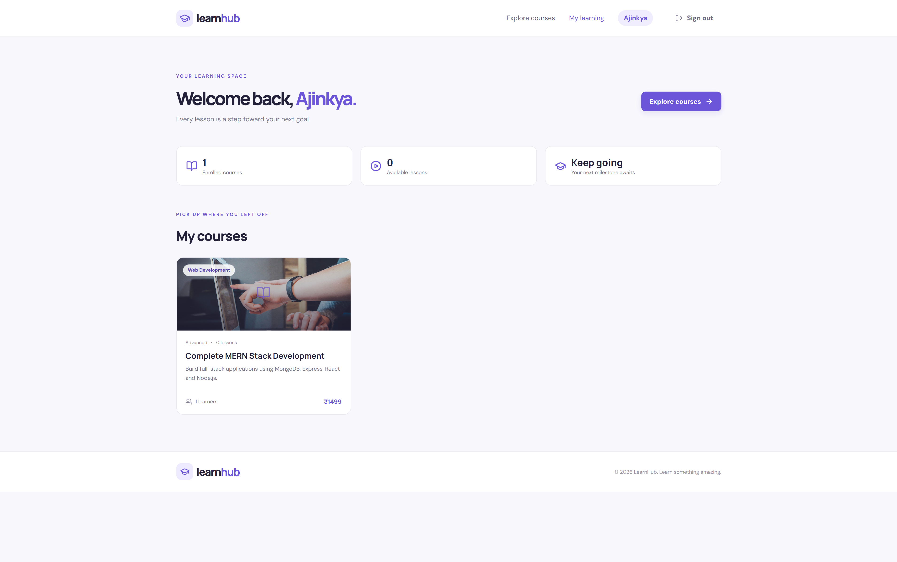
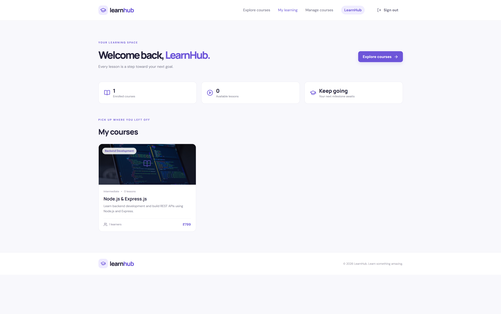
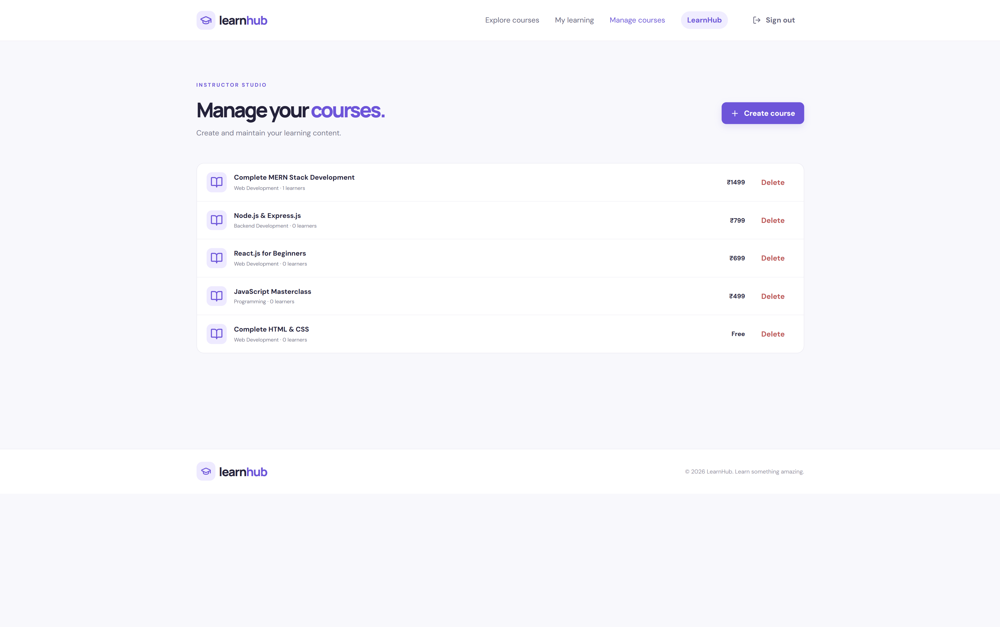

# 🎓 LearnHub – MERN Learning Management System

<p align="center">
  
  
  
  
  
  
  
  
</p>

## 📌 About The Project

**LearnHub** is a full-stack Learning Management System (LMS) developed using the MERN stack (MongoDB, Express.js, React.js, and Node.js).

The platform provides an online learning environment where students can explore courses, enroll in learning programs, and manage their learning activities. Instructors can create and manage courses through a dedicated dashboard.

The application includes JWT-based authentication, role-based access control, RESTful APIs, course management, and a responsive React frontend.

## ✨ Features

### 👨‍🎓 Student Features

- User registration and login
- Browse available courses
- View detailed course information
- Enroll in courses
- Access student dashboard
- Manage enrolled courses

### 👨‍🏫 Instructor Features

- Instructor authentication
- Dedicated instructor dashboard
- Create new courses
- Manage existing courses
- View course information
- Add and manage course content

### 🔐 Authentication & Security

- JWT-based authentication
- Password hashing with bcrypt
- Protected API routes
- Role-based authorization
- Environment-based configuration

### 🎨 UI & User Experience

- Responsive user interface
- React Router navigation
- Reusable React components
- Modern dashboard layout
- Lucide icons

## 🛠️ Technologies Used

### Frontend

- React.js
- JavaScript (ES6+)
- Vite
- React Router DOM
- Axios
- Lucide React
- CSS3

### Backend

- Node.js
- Express.js
- MongoDB
- Mongoose
- JSON Web Token (JWT)
- bcryptjs
- dotenv
- CORS

## 📁 Project Structure

```text
mern-lms/
│
├── client/
│   ├── public/
│   ├── src/
│   │   ├── components/
│   │   ├── context/
│   │   ├── pages/
│   │   ├── services/
│   │   ├── App.jsx
│   │   ├── main.jsx
│   │   └── index.css
│   ├── .env.example
│   └── package.json
│
├── server/
│   ├── config/
│   ├── middleware/
│   ├── models/
│   ├── routes/
│   ├── seedInstructor.js
│   ├── seedCourses.js
│   ├── .env.example
│   ├── server.js
│   └── package.json
│
└── README.md
```

## ⚙️ Installation & Setup

### 1. Clone the Repository

```bash
git clone https://github.com/your-username/LearnHub.git
```

### 2. Navigate to the Project Directory

```bash
cd mern-lms
```

### 3. Install Backend Dependencies

```bash
cd server
npm install
```

### 4. Configure Backend Environment Variables

Create a `.env` file inside the `server` directory.

```env
PORT=5000
MONGO_URI=your_mongodb_connection_string
JWT_SECRET=your_generated_jwt_secret
```

Generate a secure JWT secret using Node.js:

```bash
node -e "console.log(require('crypto').randomBytes(64).toString('hex'))"
```

### 5. Create the Instructor Account

Run the instructor seed script:

```bash
npm run seed:instructor
```

This creates the default instructor account.

**Default Instructor Credentials**

| Field    | Value                     |
| -------- | ------------------------- |
| Email    | `instructor@learnhub.com` |
| Password | `LearnHub@123`            |
| Role     | Instructor                |

### 6. Add Sample Courses

Run the course seed script:

```bash
npm run seed:courses
```

This inserts sample courses into MongoDB and associates them with the instructor account.

**Sample Courses**

- Complete HTML & CSS
- JavaScript Masterclass
- React.js for Beginners
- Node.js & Express.js
- Complete MERN Stack Development

### 7. Start the Backend Server

```bash
npm run dev
```

### 8. Install Frontend Dependencies

Open a new terminal:

```bash
cd client
npm install
```

### 9. Configure Frontend Environment Variables

Create a `.env` file inside the `client` directory.

```env
VITE_API_URL=http://localhost:5000/api
```

### 10. Start the Frontend Application

```bash
npm run dev
```

Open your browser and visit:

```text
http://localhost:5173
```

## 📸 Screenshots

<!-- Replace the placeholder image paths with your actual screenshots -->

### 🏠 Home Page


### 📚 Courses Page


### 📖 Course Details



### 🔐 Login Page



### 📝 Register Page


### 👨‍🎓 Student Dashboard



### 👨‍🏫 Instructor Dashboard



### ➕ Course Management



## 🔑 User Roles

| Role       | Permissions                                                 |
| ---------- | ----------------------------------------------------------- |
| Student    | Browse courses, enroll in courses, access student dashboard |
| Instructor | Create and manage courses, access instructor dashboard      |

## 🔒 Environment Variables

| Variable       | Description                            |
| -------------- | -------------------------------------- |
| `PORT`         | Backend server port                    |
| `MONGO_URI`    | MongoDB connection string              |
| `JWT_SECRET`   | Secret key used for JWT authentication |
| `VITE_API_URL` | Backend API base URL for frontend      |

## 🌱 Database Seeding

LearnHub includes seed scripts to populate the database with initial development data.

| Command                   | Description                               |
| ------------------------- | ----------------------------------------- |
| `npm run seed:instructor` | Creates or updates the default instructor |
| `npm run seed:courses`    | Adds or updates the sample courses        |

Run these commands from the `server` directory after configuring your MongoDB connection.

**Note:** The default instructor credentials are intended for local development and demonstration only. Change the password before deploying publicly. Never commit your `.env` file to GitHub.

## 🚀 Future Improvements

- Video lessons and course content management
- Lesson progress tracking
- Online quizzes and assessments
- Course reviews and ratings
- Payment gateway integration
- Course completion certificates
- Admin dashboard
- Instructor analytics
- Student performance tracking

## 👨‍💻 Author

**Ajinkya Dhatrak**

GitHub: [@ajinkya029](https://github.com/ajinkya029)

---

<p align="center">
  ⭐ If you like this project, consider giving it a star!
</p>
